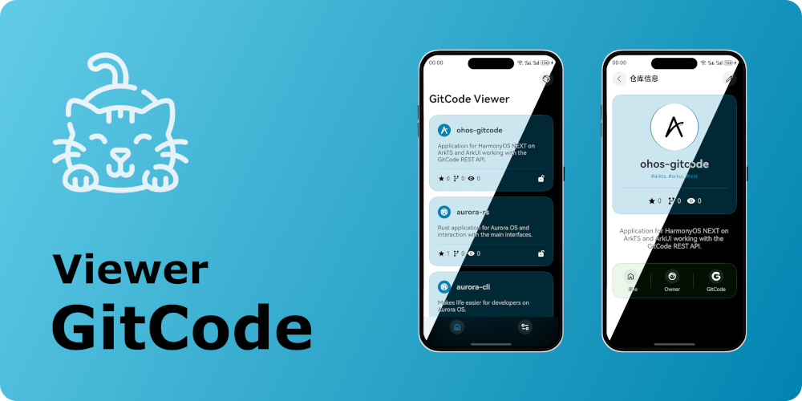

GitCode Viewer
===================

Application for HarmonyOS NEXT on 
[ArkTS](https://developer.huawei.com/consumer/en/arkts/)
and
[ArkUI](https://developer.huawei.com/consumer/en/arkui/),
working with the GitCode
[REST API](https://docs.gitcode.com/v1-docs/en/docs/guide/).

### Features

- Theme (dark/light).
- Localization (en/ru/cn).
- HTTP request (axios/rcp).
- Navigation (tabs/navigation).
- Page states (auth/loading/error).
- Plugin Hvigor (for BuildProfile).
- OAuth + Deeplink (open in browser).
- PersistentStorage & AppStorage.
- Crypto & Obfuscation.
- Refresh List/Page.
- Paging List.
- Lottie.
- Form.

### Resources
- [Google Fonts](https://fonts.google.com/icons)
- [LottieFiles](https://lottiefiles.com/)
- [Freepik](https://www.freepik.com/icons)
- [Devicon](https://github.com/devicons/devicon)